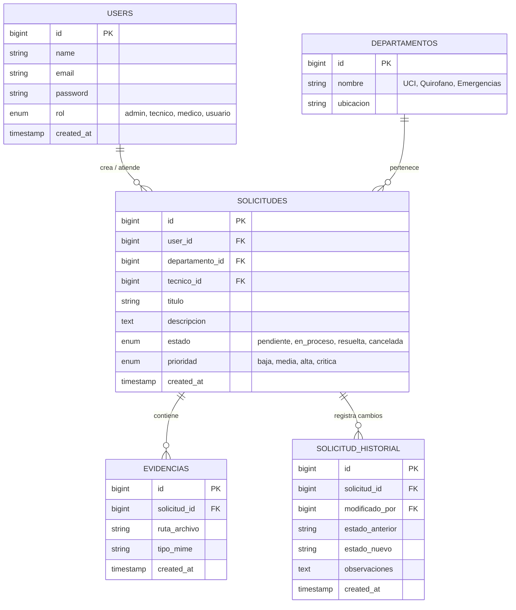

# Hospital Salud Integral — Backend y API REST

> Plataforma backend para la administración, trazabilidad y mantenimiento de equipamiento médico y solicitudes de servicio en red hospitalaria.

[](https://laravel.com)
[](https://php.net)
[-4479A1?logo=mysql&logoColor=white)](#modelo-relacional-de-base-de-datos)
[](#despliegue-con-docker)
[](#seguridad-y-control-de-acceso-rbac)
[](LICENSE)

---

## Descripción del Sistema

Este repositorio alberga la arquitectura backend del sistema de Hospital Salud Integral (Red RCH), desarrollado como Proyecto Final de Carrera en la Escuela Superior de Innovación y Tecnología (ESIT).

La solución resuelve la coordinación operativa entre el personal de salud (médicos y enfermeros en áreas críticas como quirófano, UCI y hospitalización) y el departamento de mantenimiento técnico y biomédico. Centraliza la emisión de tickets, el diagnóstico técnico, la asignación de responsables, el historial de cambios y la recepción de evidencias multimedia en tiempo real.

---

## Modelo Relacional de Base de Datos (ERD)

Diseño relacional estructurado en MySQL 8 (InnoDB) con normalización estricta, llaves foráneas, índices de alto rendimiento y trazabilidad histórica:



---

## Seguridad y Control de Acceso (RBAC)

El sistema implementa autenticación sin estado mediante Laravel Sanctum, otorgando tokens de acceso Bearer individuales. El acceso a cada recurso está restringido por Middleware según el rol del usuario:

| Rol | Permisos y Capacidades |
| :--- | :--- |
| Administrador | Control total: altas de usuarios, gestión de departamentos, reasignación de solicitudes y reportes globales. |
| Técnico Biomédico | Visualización de solicitudes asignadas (/solicitudes/mias), actualización de estados y carga de evidencias. |
| Personal Médico | Creación de solicitudes de mantenimiento urgentes, seguimiento de tickets propios y consulta de avances. |

---

## Especificación de la API RESTful

Todos los endpoints requieren el encabezado `Accept: application/json`. Las rutas privadas requieren el encabezado `Authorization: Bearer <TOKEN>`.

### Autenticación Pública
* `POST /api/login` — Autenticación de usuarios y emisión de token Bearer.
* `POST /api/password/email` — Solicitud de restablecimiento de contraseña.
* `POST /api/password/reset` — Confirmación y actualización de credenciales.

### Gestión de Solicitudes y Mantenimiento (Protegido por Sanctum)
* `GET /api/solicitudes` — Listado general con paginación, filtros por estado, prioridad y departamento.
* `POST /api/solicitudes` — Registro de una nueva solicitud de mantenimiento médico.
* `GET /api/solicitudes/{id}` — Detalle completo de una solicitud específica.
* `PUT /api/solicitudes/{id}` — Actualización de estado y asignación de personal técnico.
* `DELETE /api/solicitudes/{id}` — Baja lógica de solicitud (exclusivo Administrador).
* `GET /api/solicitudes/resumen` — Métricas cuantitativas para el panel de control administrativo.
* `GET /api/solicitudes/mias` — Solicitudes activas asignadas al técnico autenticado.
* `GET /api/solicitudes/{id}/historial` — Bitácora inmutable de cambios de estado y observaciones.

### Evidencias Multimedia
* `GET /api/solicitudes/{id}/evidencias` — Listado de fotos y documentos adjuntos al ticket.
* `POST /api/solicitudes/{id}/evidencias` — Carga de fotografías del equipo dañado o reparado.
* `DELETE /api/evidencias/{id}` — Eliminación de evidencia adjunta.

### Departamentos y Técnicos
* `GET /api/departamentos` — Áreas médicas del hospital (UCI, Radiología, Laboratorio, etc.).
* `GET /api/tecnicos` — Catálogo del personal biomédico disponible para asignación.

---

## Despliegue con Docker

El proyecto cuenta con un entorno contenerizado reproducible con Docker y Docker Compose, incluyendo PHP 8.2 FPM, servidor web Nginx, MySQL 8 y phpMyAdmin.

### 1. Clonar el repositorio
```bash
git clone https://github.com/devuek/Hospital_Salud_Integral.git
cd Hospital_Salud_Integral
```

### 2. Configurar variables de entorno
```bash
cp .env.example .env
```

### 3. Levantar los contenedores
```bash
docker compose up -d --build
```

### 4. Ejecutar migraciones y datos de prueba
```bash
docker compose exec app php artisan migrate --seed
```

### 5. Puntos de acceso locales
* API Backend (Laravel / Nginx): `http://localhost:8000`
* phpMyAdmin (Administrador de Base de Datos): `http://localhost:8080`
  * Servidor: `mysql`
  * Usuario: `root`
  * Contraseña: `root_pass`

---

## Pruebas Automatizadas

El código incluye validación de integridad mediante PHPUnit:
```bash
docker compose exec app php artisan test
```

---

## Autor

* Eleazar Neftalí Trejo López
  * GitHub: [@devuek](https://github.com/devuek)
  * Rol: Desarrollador Backend y Arquitectura de Base de Datos
  * Institución: Escuela Superior de Innovación y Tecnología (ESIT)
